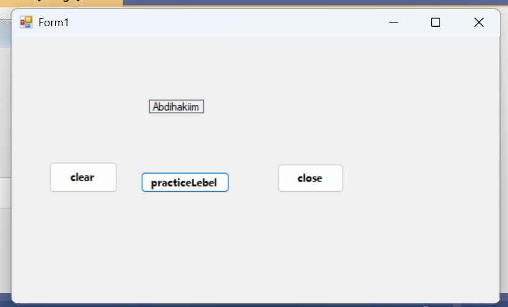

---

screenshot kaan waxaan ku practice gareeye, sida label looga badalo text ayadoo la isticmaalaayo 
buttons 

# properties ka aan isticmaalay waxaa ka mid ah :

1. borderStyle
2. textAlignment
3. autoSize
4. name 
5. font

# Controls ka aan isticmaalay waxaa ka mid ah :

1. Button 
2. Label
3. TextBox
4.PictureBox